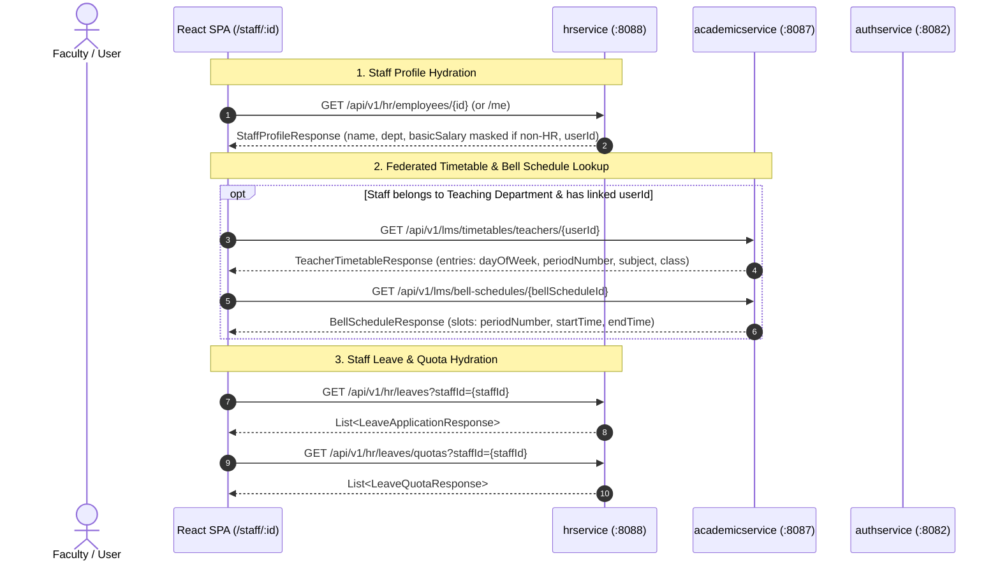
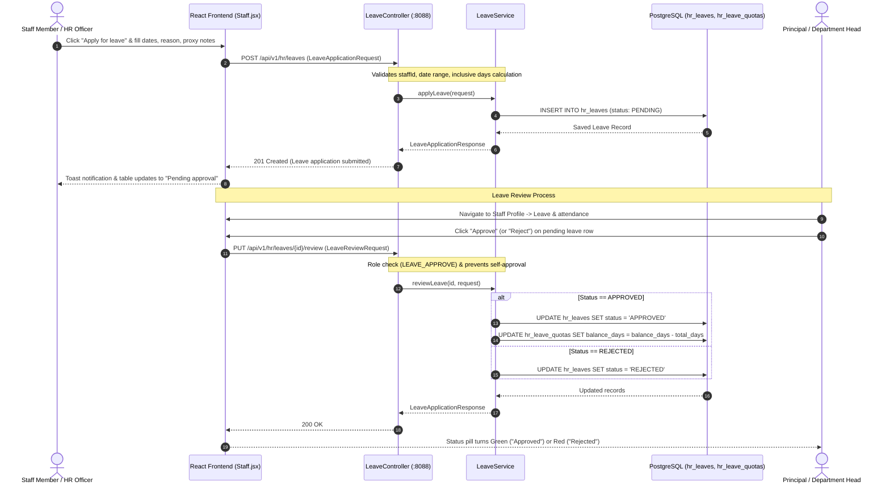
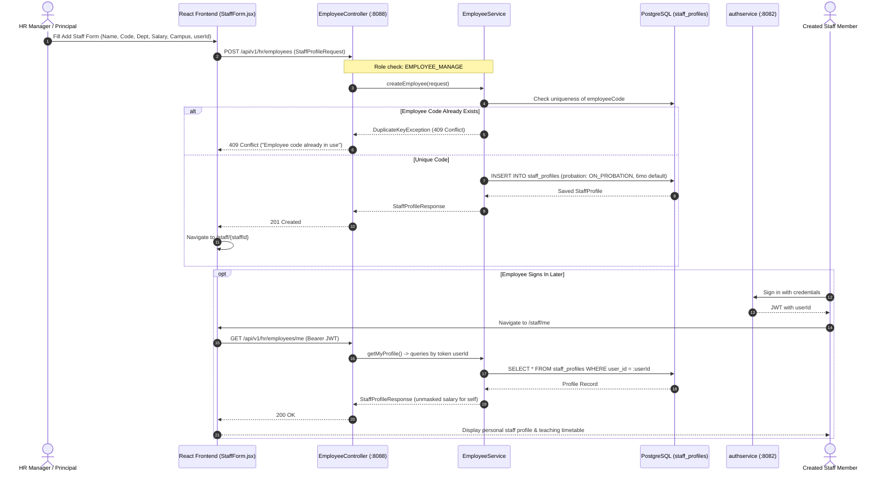
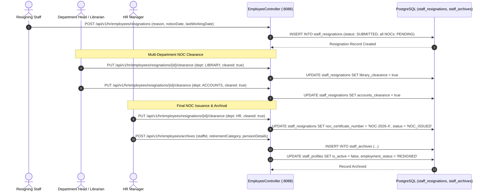

# UI Breakdown & Service Analysis: hrservice (Module 07)

This document provides a comprehensive audit of the **Staff HR, Biometric Attendance & Payroll Operations** microservice (`hrservice`) and its corresponding frontend implementation in the School ERP React web application (`frontend/`).

---

## Metadata & Architecture Reference

| Property | Value |
|---|---|
| **Module** | Module 07 — Staff HR, Biometric Attendance & Payroll Operations |
| **Microservice** | `hrservice` |
| **Base Package** | `com.kvs.hr` |
| **Server Port** | `8088` (Test port `18088`) |
| **Servlet Context Path** | `/hrservice` |
| **Reverse Proxy Prefixes** | `/api/v1/hr/*` |
| **Primary Frontend Routes** | `/staff`, `/staff/:id`, `/staff/me`, `/staff/new`, `/staff/:id/edit` |
| **Key Frontend Files** | [`src/pages/Staff.jsx`](file:///c:/dev/schoolerp/frontend/src/pages/Staff.jsx), [`src/api/hrService.js`](file:///c:/dev/schoolerp/frontend/src/api/hrService.js), [`src/App.jsx`](file:///c:/dev/schoolerp/frontend/src/App.jsx) |
| **Cross-Module Integrations** | [`src/api/academicService.js`](file:///c:/dev/schoolerp/frontend/src/api/academicService.js) (`academicservice` timetables and bell schedules), `authservice` (user accounts & system roles) |
| **User Stories Covered** | `US-07000` through `US-07019` (All 20 base user stories) |

```mermaid
flowchart LR
    Browser["React SPA (Vite Dev :5173 / Nginx)"]
    Proxy["Reverse Proxy (/api/v1/hr/*)"]
    HRService["hrservice (:8088/hrservice)"]
    AcademicService["academicservice (:8087/academicservice)"]
    AuthService["authservice (:8082/authservice)"]
    DB[(PostgreSQL: authservice DB)]

    Browser -->|HTTP / Bearer JWT| Proxy
    Proxy -->|Rewritten to :8088/hrservice/api/v1/hr/*| HRService
    Browser -->|/api/v1/lms/timetables/teachers/*| AcademicService
    Browser -->|/api/v1/auth/me| AuthService
    HRService -->|JPA / Hibernate (ddl-auto: update)| DB
    AcademicService -->|JPA / Hibernate| DB
    AuthService -->|JPA / Hibernate| DB
```

---

## 1. Service & Frontend Overview

`hrservice` handles staff human resources, biometric terminal attendance logging, flexible shift scheduling, statutory leave tracking, automated gross-to-net payroll computation, encrypted PDF payslips, staff professional development (CPD), and employee lifecycle events (probation, appraisals, resignations, NOC clearance, settlements, and archival).

The frontend interface for `hrservice` is centralized in [`src/pages/Staff.jsx`](file:///c:/dev/schoolerp/frontend/src/pages/Staff.jsx) with client bindings in [`src/api/hrService.js`](file:///c:/dev/schoolerp/frontend/src/api/hrService.js). The UI surfaces a staff directory, personal staff profile with timetable and leave management, and staff creation/editing forms.

### Network & Routing Configuration

| Component | Target URL | Context Path | Proxy Prefix |
|---|---|---|---|
| **Vite Dev Server** | `http://localhost:5173` | `/` | — |
| **hrservice** | `http://localhost:8088` | `/hrservice` | `/api/v1/hr` |
| **academicservice** | `http://localhost:8087` | `/academicservice` | `/api/v1/lms` |
| **authservice** | `http://localhost:8082` | `/authservice` | `/api` |

---

## 2. Complete UI Screen & Navigation Hierarchy

The application surfaces `hrservice` functionality across the `/staff` hierarchy:

```
├── /staff (Staff & Faculty Directory)
│   ├── Page Header Actions
│   │   ├── Export list (Browser-generated CSV)
│   │   └── Add staff member (Navigates to /staff/new; Role-gated: HR_MANAGER, SCHOOL_PRINCIPAL, PRINCIPAL, SUPER_ADMIN)
│   ├── Metrics Bar
│   │   ├── Total staff (Current active headcount, breakdown of teaching vs support)
│   │   ├── On campus today (Biometric present count & % punched in; Role-gated: attendance roles)
│   │   ├── On leave today (Approved leaves covering current date)
│   │   └── Leave requests (Pending leave approvals)
│   ├── Tabbed Directory
│   │   ├── Tab: All staff (Active enrolled staff)
│   │   ├── Tab: Teaching (Staff in teaching departments)
│   │   ├── Tab: Support (Staff in administrative / operational departments)
│   │   └── Tab: Archived (Resigned, retired, or terminated staff)
│   ├── Search & Filter Toolbar
│   │   ├── SearchBox (Name, employee code, role, or email)
│   │   ├── Department Select (All departments + distinct departments in dataset)
│   │   └── Availability Select (All availability, Available, On leave today)
│   ├── Data Table
│   │   ├── Columns: Staff member, Role, Department, Type, Availability, Actions
│   │   └── Row Actions: "View profile" (/staff/:staffId), "Edit" (/staff/:staffId/edit)
│   └── Dashboard Cards
│       ├── Leave & cover (Staff on leave today + cover notes + pending requests pill + link to /teaching)
│       └── Probation & reviews (Staff on probation with review due dates + links to profiles)
├── /staff/new (Add Staff Member)
│   ├── Form Sections: Personal & contact, Employment information, Notice card, Qualifications, Teaching assignments note
│   └── Formbar: "Draft not yet saved" with "Cancel" and "Save changes" (POST /api/v1/hr/employees)
├── /staff/:staffId or /staff/me (Staff Profile)
│   ├── Header Card (Name, Employee code, Designation, Department, Availability pill, Contract terms, Probation status, Email, Phone, Joining date)
│   ├── Header Actions
│   │   ├── Back to staff (/staff)
│   │   ├── Message staff (mailto: anchor)
│   │   └── Edit staff details (/staff/:staffId/edit; Role-gated)
│   ├── Profile Navigation Tabs
│   │   ├── Tab 0: Overview (Dual-column stack containing assignments, timetable, qualifications, employment, leave, pay)
│   │   ├── Tab 1: Teaching assignments (Class, Subject, Lessons/week from academicservice)
│   │   ├── Tab 2: Timetable (Today's lessons & Weekly period schedule grid via academicservice)
│   │   ├── Tab 3: Leave & attendance (Leave taken, Pending, Balance quotas, History table, Approve/Reject buttons, Record leave button)
│   │   └── Tab 4: Documents (Document vault notice + Pay & statutory card)
│   └── Modal: RecordLeaveModal
│       └── Form: Leave type, First day, Last day, Reason, Cover notes (POST /api/v1/hr/leaves)
└── /staff/:staffId/edit (Edit Staff Details)
    ├── Prepopulated form with existing employee profile data
    └── Formbar: "Employee <CODE>" with "Cancel" and "Save changes" (PUT /api/v1/hr/employees/:staffId)
```

---

## 3. Screen-by-Screen Visual & Interactive Controls Inventory

### 3.1 Staff & Faculty Directory (`/staff`)

* **Page Header**:
  * **Title**: `Staff & faculty`
  * **Description**: `Manage your teaching and support teams, leave and employment records.`
  * **Action: Export list** (Download icon): Generates and downloads `staff.csv` containing columns `Name`, `Employee code`, `Role`, `Department`, `Type`, `Availability`, `Email`, `Phone`. Disabled if 0 rows visible.
  * **Action: Add staff member** (Plus icon): Navigates to `/staff/new`. Visible only to `HR_MANAGER`, `SCHOOL_PRINCIPAL`, `PRINCIPAL`, `SUPER_ADMIN`.
* **Top Metric Cards**:
  * **Total staff**: Formatted active staff count (`current.length`), subtext displays `<teaching> teaching · <support> support`.
  * **On campus today**: Displays `summary.data.presentCount` and `% punched in` from `GET /api/v1/hr/attendance/summary?date=<today>`. Role-gated to `attendance` roles (`SCHOOL_PRINCIPAL`, `PRINCIPAL`, `VICE_PRINCIPAL`, `COMPLIANCE_OFFICER`, `HR_MANAGER`, `DEPARTMENT_HEAD`, `SUPER_ADMIN`). Other users see `—` with subtext `Biometric attendance · principal and HR`.
  * **On leave today**: Formatted count of staff having an approved leave covering today's date (`GET /api/v1/hr/leaves`).
  * **Leave requests**: Formatted count of applications with `status === 'PENDING'`.
* **Directory Card & Controls**:
  * **Tabs**:
    * `All staff (<count>)`: Active current staff (`isActive !== false` and not resigned/retired/terminated).
    * `Teaching (<count>)`: Active staff whose department is in `TEACHING_DEPARTMENTS` (`Mathematics`, `Science`, `English`, `Hindi`, `Social Science`, `Computer Science`, `Physical Education`).
    * `Support (<count>)`: Active staff outside teaching departments.
    * `Archived (<count>)`: Staff marked `RESIGNED`, `RETIRED`, `TERMINATED`, or `isActive === false`.
  * **Search Box**: Free-text filter on employee full name, employee code, designation, or email.
  * **Department Filter**: Dropdown populated dynamically with distinct departments in the dataset.
  * **Availability Filter**: Options: `All availability`, `Available`, `On leave today`.
  * **Data Table Columns**:
    * `Staff member`: Avatar with initials, full name, employee code.
    * `Role`: Employee designation (e.g., `TGT Mathematics`, `Senior Accountant`).
    * `Department`: Department name.
    * `Type`: `Teaching` or `Support`.
    * `Availability`: Status pill (`Available` [green], `On <leave>` [amber], `Notice period` [amber], `Resigned` / `Retired` [muted], `Terminated` [red]).
    * `Actions`:
      * `View profile` link $\rightarrow$ `/staff/:staffId`.
      * `Edit` link $\rightarrow$ `/staff/:staffId/edit` (Role-gated to `HR_MANAGER`, `SCHOOL_PRINCIPAL`, `PRINCIPAL`, `SUPER_ADMIN`).
  * **Pagination**: 10 items per page with `<Pager />` control (`Showing X–Y of Z staff members`).
* **Sidebar / Bottom Cards**:
  * **Leave & cover**: Lists each staff member on leave today with leave type, date range, and proxy cover notes. Contains a pending pill badge (`N requests pending`) and link to `/teaching`.
  * **Probation & reviews**: Displays staff members on probation (`probationStatus !== 'CONFIRMED'`) along with review due date (`probationEndDate`) and link to their profile.

---

### 3.2 Staff Profile (`/staff/:staffId` and `/staff/me`)

* **Page Header**:
  * Title: `My staff profile` (if viewing own record via `/staff/me` or matching user ID) or `Staff profile`.
  * Action `Back to staff`: Navigates back to `/staff`.
  * Action `Message staff`: Triggered via `mailto:<email>`.
  * Action `Edit staff details`: Navigates to `/staff/:staffId/edit` (Role-gated).
* **Summary Hero Card**:
  * Initials avatar (`bigavatar`), Full Name, Employee Code, Designation, Department.
  * Status pills: Availability tone/text, Contract terms pill (purple), Probation status pill (amber).
  * Right column: Email mailto link, mobile phone, and formatted joining date.
* **Navigation Tabs**: `Overview`, `Teaching assignments`, `Timetable`, `Leave & attendance`, `Documents`.
* **Tab 0: Overview**:
  * Left Stack:
    * `Teaching assignments` card: Table of Class, Subject, and Lessons/week derived from LMS teacher timetable.
    * `Today’s timetable` card: Time slots and lesson details for the current day.
    * `Qualifications & professional development` card: Qualifications text, latest CPD training, and cumulative hours/credits earned this year.
  * Right Stack:
    * `Employment & contact` card: Department, Role, Contract terms, Probation status & review date, Campus code, Joining date.
    * `Leave & attendance` card: Approved leave taken count, Pending requests count, Balance quotas per leave type (Casual, Sick, Earned, Maternity, etc.), Upcoming leave banner, Leave history table with row-level `Approve` / `Reject` buttons, and `Apply for leave` / `Record leave` button.
    * `Pay & statutory details` card: Basic salary formatted as currency, PAN number, PF UAN, Bank details (masked account number showing last 4 digits, bank name, IFSC). **Role-gated**: Rendered only when `basicSalary` is present (returned only to confidential pay viewers and own profile).
* **Tab 1: Teaching assignments**:
  * Displays full `Teaching assignments` table and `Qualifications` card.
* **Tab 2: Timetable**:
  * Displays `Today’s timetable` and interactive weekly `TimetableGrid` from `TeachingLive.jsx` cross-referencing `academicservice` bell schedules.
* **Tab 3: Leave & attendance**:
  * Full-width view of leave quotas, upcoming leave, historical leave table with review controls, and leave application trigger.
* **Tab 4: Documents**:
  * Restricted HR documents placeholder note (`hrservice has no document vault endpoint yet`) + Pay & statutory card.
* **Modal: RecordLeaveModal**:
  * Triggered by `Apply for leave` (on own profile) or `Record leave` (by HR officers for other staff).
  * Fields:
    * `LEAVE TYPE *` (Select: `CASUAL`, `SICK`, `EARNED`, `MATERNITY`, `PATERNITY`, `LWP`).
    * `FIRST DAY *` (Date input, defaults to today).
    * `LAST DAY *` (Date input, defaults to today).
    * `REASON *` (Text input: "Why the leave is needed").
    * `COVER NOTES` (Text input: "Optional: who covers the lessons").
  * Explanatory footer: Days counted inclusive of weekends.
  * Submit button calls `POST /api/v1/hr/leaves`.

---

### 3.3 Add / Edit Staff Member (`/staff/new` and `/staff/:staffId/edit`)

* **Page Header**:
  * Title: `Add staff member` or `Edit staff details`.
  * Action `Back to staff` or `Back to profile`.
* **Permission Banner**:
  * If the logged-in user lacks `HR_MANAGER`, `SCHOOL_PRINCIPAL`, `PRINCIPAL`, or `SUPER_ADMIN`, displays `<ApiNote>`: `Only HR, the principal or a super administrator can add or edit staff records.` and disables the save button.
* **Form Sections**:
  * **Personal & contact details**:
    * Initials avatar, Employee code pill (in edit mode).
    * `First name *` (Text input).
    * `Last name *` (Text input).
    * `Work email` (Email input).
    * `Mobile number` (Phone input).
  * **Employment information**:
    * `Employee code *` (Text input in new mode, Read-only in edit mode).
    * `Role / job title *` (Text input, e.g., `TGT Mathematics`).
    * `Department *` (Select dropdown populated with 15 standard school departments).
    * `Start date *` (Date input).
    * `Contract` (Select dropdown: `Permanent Full-Time`, `Probationary Contract`, `Fixed-Term`, `Part-Time 0.7 FTE`).
    * `Probation ends` (Date input in new mode, defaults to 6 months after start date; Read-only status in edit mode).
    * `Basic salary / month *` (Number input, e.g., `45000`).
    * `Campus *` (Text input, defaults to current active `branchId`).
    * `Sign-in account ID` (Text input, links profile to `authservice` `users.user_id`).
  * **Qualifications**:
    * `Qualifications` (Text input, e.g., `M.Sc Mathematics, B.Ed`).
  * **Notice Card**:
    * Explains probation default and notes that PAN, Aadhaar, PF/ESI, and bank details are preserved on edit.
  * **Teaching assignments & access**:
    * Explains that timetable assignments come from Module 06 (`academicservice`) and system login roles are managed in Settings (`authservice`).
* **Sticky Bottom Formbar**:
  * Status text: `Draft not yet saved` or `Employee <CODE>`.
  * Actions: `Cancel` button and `Save changes` primary button (POST `/api/v1/hr/employees` or PUT `/api/v1/hr/employees/:staffId`).

---

## 4. End-to-End UI-to-Backend API Mapping Catalog

| UI Screen / Component | Action / Trigger | HTTP & Endpoint | Request Payload / Query Params | Response DTO | Backend Controller Method | Roles (`@PreAuthorize`) | Wiring Status |
|---|---|---|---|---|---|---|---|
| Directory (`/staff`) | Initial load & tab switch | `GET /api/v1/hr/employees` | `branchId` (string, optional) | `ApiResponse<List<StaffProfileResponse>>` | `EmployeeController.listEmployees` | `STAFF_VIEW` | **Wired** |
| Directory (`/staff`) | Leave indicators & count | `GET /api/v1/hr/leaves` | None (lists all leaves) | `ApiResponse<List<LeaveApplicationResponse>>` | `LeaveController.listLeaves` | `STAFF_VIEW` | **Wired** |
| Directory (`/staff`) | Metric "On campus today" | `GET /api/v1/hr/attendance/summary` | `date=YYYY-MM-DD` | `ApiResponse<AttendanceSummaryResponse>` | `BiometricAttendanceController.getAttendanceSummary` | `ATTENDANCE_ANALYTICS` | **Role-gated** |
| Directory (`/staff`) | "Export list" button | Client-side CSV generation | Client memory filtered rows | Browser download (`staff.csv`) | — | Client-side | **Wired** |
| Profile (`/staff/:id`) | Profile load by ID | `GET /api/v1/hr/employees/{staffId}` | Path: `staffId` (UUID) | `ApiResponse<StaffProfileResponse>` | `EmployeeController.getEmployee` | `STAFF_VIEW` | **Wired** |
| Profile (`/staff/me`) | Profile load for self | `GET /api/v1/hr/employees/me` | None (reads token `userId`) | `ApiResponse<StaffProfileResponse>` | `EmployeeController.getMyProfile` | `STAFF_VIEW` | **Wired** |
| Profile (`/staff/:id`) | Leave history & taken | `GET /api/v1/hr/leaves` | `staffId={staffId}` | `ApiResponse<List<LeaveApplicationResponse>>` | `LeaveController.listLeaves` | `STAFF_VIEW` | **Wired** |
| Profile (`/staff/:id`) | Quotas balance row | `GET /api/v1/hr/leaves/quotas` | `staffId={staffId}`, `quotaYear={year}` | `ApiResponse<List<LeaveQuotaResponse>>` | `LeaveController.listQuotas` | `STAFF_VIEW` | **Wired** |
| Profile (`/staff/:id`) | CPD training credits | `GET /api/v1/hr/development/cpd/{staffId}` | Path: `staffId` (UUID) | `ApiResponse<List<CpdRecordResponse>>` | `StaffDevelopmentController.listCpd` | `STAFF_VIEW` | **Wired** |
| Profile Modal | Submit "Record leave" | `POST /api/v1/hr/leaves` | `LeaveApplicationRequest` (JSON) | `ApiResponse<LeaveApplicationResponse>` | `LeaveController.applyLeave` | `LEAVE_APPLY` (`STAFF_VIEW`) | **Wired** |
| Profile Table | "Approve" leave row | `PUT /api/v1/hr/leaves/{applicationId}/review` | `LeaveReviewRequest` (`status: "APPROVED"`) | `ApiResponse<LeaveApplicationResponse>` | `LeaveController.reviewLeave` | `LEAVE_APPROVE` | **Role-gated** |
| Profile Table | "Reject" leave row | `PUT /api/v1/hr/leaves/{applicationId}/review` | `LeaveReviewRequest` (`status: "REJECTED"`) | `ApiResponse<LeaveApplicationResponse>` | `LeaveController.reviewLeave` | `LEAVE_APPROVE` | **Role-gated** |
| Profile Tab | Teaching timetable | `GET /api/v1/lms/timetables/teachers/{userId}` | Path: `userId` (UUID) | `ApiResponse<TeacherTimetableResponse>` | `academicService` LMS Controller | LMS roles | **Wired (Federated)** |
| Profile Tab | Bell schedule slot lookup | `GET /api/v1/lms/bell-schedules/{id}` | Path: `id` (UUID) | `ApiResponse<BellScheduleResponse>` | `academicService` LMS Controller | LMS roles | **Wired (Federated)** |
| Add Form (`/staff/new`) | "Save changes" submit | `POST /api/v1/hr/employees` | `StaffProfileRequest` (JSON) | `ApiResponse<StaffProfileResponse>` | `EmployeeController.createEmployee` | `EMPLOYEE_MANAGE` | **Role-gated** |
| Edit Form (`/staff/:id/edit`) | Load employee details | `GET /api/v1/hr/employees/{staffId}` | Path: `staffId` (UUID) | `ApiResponse<StaffProfileResponse>` | `EmployeeController.getEmployee` | `STAFF_VIEW` | **Wired** |
| Edit Form (`/staff/:id/edit`) | "Save changes" update | `PUT /api/v1/hr/employees/{staffId}` | `StaffProfileRequest` (JSON) | `ApiResponse<StaffProfileResponse>` | `EmployeeController.updateEmployee` | `EMPLOYEE_MANAGE` | **Role-gated** |
| Backend API | Biometric punch ingest | `POST /api/v1/hr/attendance/scans` | `BiometricScanRequest` (JSON) | `ApiResponse<BiometricScanResponse>` | `BiometricAttendanceController.ingestScan` | `BIOMETRIC_INGEST` | **Backend-Only** |
| Backend API | List biometric scans | `GET /api/v1/hr/attendance/scans/{staffId}` | Path: `staffId` (UUID) | `ApiResponse<List<BiometricScanResponse>>` | `BiometricAttendanceController.listScans` | `STAFF_VIEW` | **Backend-Only** |
| Backend API | Create shift schedule | `POST /api/v1/hr/attendance/shifts` | `StaffShiftRequest` (JSON) | `ApiResponse<StaffShiftResponse>` | `BiometricAttendanceController.createShift` | `SHIFT_ROSTER` | **Backend-Only** |
| Backend API | List shift schedules | `GET /api/v1/hr/attendance/shifts` | None | `ApiResponse<List<StaffShiftResponse>>` | `BiometricAttendanceController.listShifts` | `STAFF_VIEW` | **Backend-Only** |
| Backend API | Assign shift to staff | `POST /api/v1/hr/attendance/shifts/assignments` | `ShiftAssignmentRequest` (JSON) | `ApiResponse<Void>` | `BiometricAttendanceController.assignShift` | `SHIFT_ROSTER` | **Backend-Only** |
| Backend API | Flag biometric anomaly | `POST /api/v1/hr/attendance/anomalies/{staffId}` | `anomalyDate`, `type` (Query params) | `ApiResponse<BiometricAnomalyResponse>` | `BiometricAttendanceController.flagAnomaly` | `ANOMALY_REGULARISE` | **Backend-Only** |
| Backend API | Regularise punch anomaly | `PUT /api/v1/hr/attendance/anomalies/{id}/regularise` | `AnomalyRegularisationRequest` (JSON) | `ApiResponse<BiometricAnomalyResponse>` | `BiometricAttendanceController.regulariseAnomaly` | `ANOMALY_REGULARISE` | **Backend-Only** |
| Backend API | List punch anomalies | `GET /api/v1/hr/attendance/anomalies` | `staffId` (UUID, optional) | `ApiResponse<List<BiometricAnomalyResponse>>` | `BiometricAttendanceController.listAnomalies` | `STAFF_VIEW` | **Backend-Only** |
| Backend API | Configure leave quota | `POST /api/v1/hr/leaves/quotas` | `LeaveQuotaRequest` (JSON) | `ApiResponse<LeaveQuotaResponse>` | `LeaveController.configureQuota` | `STATUTORY_QUOTAS` | **Backend-Only** |
| Backend API | Record appraisal review | `POST /api/v1/hr/employees/appraisals` | `StaffAppraisalRequest` (JSON) | `ApiResponse<StaffAppraisalResponse>` | `EmployeeController.recordAppraisal` | `PROBATION_APPRAISAL` | **Backend-Only** |
| Backend API | List employee appraisals | `GET /api/v1/hr/employees/{staffId}/appraisals` | Path: `staffId` (UUID) | `ApiResponse<List<StaffAppraisalResponse>>` | `EmployeeController.listAppraisals` | `STAFF_VIEW` | **Backend-Only** |
| Backend API | Submit resignation | `POST /api/v1/hr/employees/resignations` | `StaffResignationRequest` (JSON) | `ApiResponse<StaffResignationResponse>` | `EmployeeController.submitResignation` | `RESIGNATION_CLEARANCE` | **Backend-Only** |
| Backend API | Update department NOC | `PUT /api/v1/hr/employees/resignations/{id}/clearance` | `DepartmentClearanceRequest` (JSON) | `ApiResponse<StaffResignationResponse>` | `EmployeeController.updateClearance` | `RESIGNATION_CLEARANCE` | **Backend-Only** |
| Backend API | Get resignation details | `GET /api/v1/hr/employees/resignations/{id}` | Path: `resignationId` (UUID) | `ApiResponse<StaffResignationResponse>` | `EmployeeController.getResignation` | `STAFF_VIEW` | **Backend-Only** |
| Backend API | Archive staff record | `POST /api/v1/hr/employees/archives` | `StaffArchiveRequest` (JSON) | `ApiResponse<StaffArchiveResponse>` | `EmployeeController.archiveStaff` | `ARCHIVE_MANAGE` | **Backend-Only** |
| Backend API | List archived records | `GET /api/v1/hr/employees/archives` | None | `ApiResponse<List<StaffArchiveResponse>>` | `EmployeeController.listArchives` | `ARCHIVE_MANAGE` | **Backend-Only** |
| Backend API | Calculate payroll | `POST /api/v1/hr/payroll/calculate` | `PayrollCalculationRequest` (JSON) | `ApiResponse<PayrollResponse>` | `PayrollController.calculatePayroll` | `PAYROLL_CALCULATE` | **Backend-Only** |
| Backend API | Get payroll by ID | `GET /api/v1/hr/payroll/{payrollId}` | Path: `payrollId` (UUID) | `ApiResponse<PayrollResponse>` | `PayrollController.getPayroll` | `STAFF_VIEW` | **Backend-Only** |
| Backend API | List monthly payrolls | `GET /api/v1/hr/payroll` | `staffId`, `payYear`, `payMonth` | `ApiResponse<List<PayrollResponse>>` | `PayrollController.listPayrolls` | `STAFF_VIEW` | **Backend-Only** |
| Backend API | Calculate LWP deduction | `GET /api/v1/hr/payroll/lwp-deduction/{staffId}` | `payMonth`, `payYear` (Query params) | `ApiResponse<LwpCalculationResponse>` | `PayrollController.calculateLwpDeduction` | `LWP_DEDUCTION` | **Backend-Only** |
| Backend API | Generate statutory returns | `GET /api/v1/hr/payroll/statutory-returns` | `reportType` (PF/ESI), `payMonth`, `payYear` | `ApiResponse<StatutoryReportResponse>` | `PayrollController.generateStatutoryReturns` | `STATUTORY_REPORTS` | **Backend-Only** |
| Backend API | Dispatch encrypted payslip | `POST /api/v1/hr/payroll/payslips/dispatch` | `PayslipGenerateRequest` (JSON) | `ApiResponse<PayslipResponse>` | `PayrollController.dispatchPayslip` | `PAYSLIP_DISTRIBUTE` | **Backend-Only** |
| Backend API | Download payslip PDF | `GET /api/v1/hr/payroll/payslips/{payrollId}/pdf` | `payrollId`, `password` (Query param) | Raw byte array (`application/pdf`) | `PayrollController.downloadPayslipPdf` | `STAFF_VIEW` | **Backend-Only** |
| Backend API | Export bank payout batch | `POST /api/v1/hr/payroll/bank-payouts` | `BankPayoutBatchRequest` (JSON) | `ApiResponse<BankPayoutBatchResponse>` | `PayrollController.exportBankPayout` | `BANK_DISBURSEMENT` | **Backend-Only** |
| Backend API | List bank payout batches | `GET /api/v1/hr/payroll/bank-payouts` | None | `ApiResponse<List<BankPayoutBatchResponse>>` | `PayrollController.listBankPayouts` | `BANK_DISBURSEMENT` | **Backend-Only** |
| Backend API | Submit tax declaration | `POST /api/v1/hr/payroll/tax-declarations` | `TaxDeclarationRequest` (JSON) | `ApiResponse<TaxDeclarationResponse>` | `PayrollController.submitTaxDeclaration` | `TAX_DECLARATION` | **Backend-Only** |
| Backend API | Get tax declaration | `GET /api/v1/hr/payroll/tax-declarations/{staffId}` | `financialYear` (Query param) | `ApiResponse<TaxDeclarationResponse>` | `PayrollController.getTaxDeclaration` | `STAFF_VIEW` | **Backend-Only** |
| Backend API | Generate budget forecast | `POST /api/v1/hr/payroll/forecasts` | `PayrollForecastRequest` (JSON) | `ApiResponse<PayrollForecastResponse>` | `PayrollController.generateForecast` | `PAYROLL_FORECAST` | **Backend-Only** |
| Backend API | List budget forecasts | `GET /api/v1/hr/payroll/forecasts` | `fiscalYear` (Query param) | `ApiResponse<List<PayrollForecastResponse>>` | `PayrollController.listForecasts` | `PAYROLL_FORECAST` | **Backend-Only** |
| Backend API | Log CPD training record | `POST /api/v1/hr/development/cpd` | `CpdRecordRequest` (JSON) | `ApiResponse<CpdRecordResponse>` | `StaffDevelopmentController.logCpd` | `CPD_MANAGE` | **Backend-Only** |
| Backend API | Calculate exit settlement | `POST /api/v1/hr/development/settlement` | `StaffSettlementRequest` (JSON) | `ApiResponse<StaffSettlementResponse>` | `StaffDevelopmentController.calculateSettlement` | `OFFBOARDING_SETTLEMENT` | **Backend-Only** |
| Backend API | Get exit settlement | `GET /api/v1/hr/development/settlement/{staffId}` | Path: `staffId` (UUID) | `ApiResponse<StaffSettlementResponse>` | `StaffDevelopmentController.getSettlement` | `OFFBOARDING_SETTLEMENT` | **Backend-Only** |
| Discovery API | Dynamic RBAC rules catalog | `GET /api/v1/hr/access-rules` | None | `ApiResponse<List<AccessRuleResponse>>` | `AccessRuleController.list` | `isAuthenticated()` | **Wired (Discovery)** |

---

## 5. Role-Based Access Control (RBAC) & View-Gating Matrix

### 5.1 Role Definitions & Permission Sets

`hrservice` bridges the BRD role nomenclature with the production security role codes issued by `authservice` (`HrRoles.java`).

| Role Group | Roles Included | Permissions & UI Scope |
|---|---|---|
| **School Staff** (`STAFF_VIEW`) | Every staff role (`SUBJECT_TEACHER`, `CLASS_TEACHER`, `HOUSE_MASTER`, `TEACHER`, `ADMIN_CLERK`, `OFFICE_CLERK`, `STAFF`, `PRINCIPAL`, `SCHOOL_PRINCIPAL`, `VICE_PRINCIPAL`, `HR_MANAGER`, `PAYROLL_ACCOUNTANT`, `COMPLIANCE_OFFICER`, `DEPARTMENT_HEAD`, `AUDITOR`, `TRUSTEE`, `IT_SYSTEM_ADMIN`, `FINANCE_OFFICER`, `ADMISSION_OFFICER`, `SCHOOL_NURSE`, `EXAM_CONTROLLER`, `SUPER_ADMIN`). *Parents and students excluded.* | Read access to `/staff` directory, active staff profiles, own profile (`/staff/me`), leave records, and CPD training records. |
| **Confidential Pay Viewers** | `HR_MANAGER`, `PAYROLL_ACCOUNTANT`, `SCHOOL_PRINCIPAL`, `PRINCIPAL`, `SUPER_ADMIN`, and the employee viewing their own profile. | Access to confidential remuneration fields: `basicSalary`, `panNumber`, `pfUan`, `bankName`, `bankAccountNumber`, `bankIfsc`. For all other viewers, the backend sets these fields to `null`. |
| **HR Managers & Leadership** (`EMPLOYEE_MANAGE`) | `HR_MANAGER`, `SCHOOL_PRINCIPAL`, `PRINCIPAL`, `SUPER_ADMIN`. | Full CRUD over employee master profiles (`POST /api/v1/hr/employees`, `PUT /api/v1/hr/employees/{id}`). Enables `Add staff member` button and `/staff/:id/edit` screen. |
| **Leave Approvers** (`LEAVE_APPROVE`) | `HR_MANAGER`, `DEPARTMENT_HEAD`, `SCHOOL_PRINCIPAL`, `PRINCIPAL`, `VICE_PRINCIPAL`, `SUPER_ADMIN`. | Approve or reject pending leave requests via `PUT /api/v1/hr/leaves/{id}/review`. Approval automatically decrements employee quota balance. Approvers cannot approve their own leave. |
| **HR Officers** (`hrOfficer`) | `HR_MANAGER`, `PAYROLL_ACCOUNTANT`, `SCHOOL_PRINCIPAL`, `PRINCIPAL`, `VICE_PRINCIPAL`, `DEPARTMENT_HEAD`, `SUPER_ADMIN`. | May record leave on behalf of other staff members via `<RecordLeaveModal />`. Other staff can apply for leave only on their own profile. |
| **Attendance Analytics** | `SCHOOL_PRINCIPAL`, `PRINCIPAL`, `VICE_PRINCIPAL`, `COMPLIANCE_OFFICER`, `HR_MANAGER`, `DEPARTMENT_HEAD`, `SUPER_ADMIN`. | Access to daily biometric attendance dashboard metric (`GET /api/v1/hr/attendance/summary`). |
| **Payroll & Finance** | `PAYROLL_ACCOUNTANT`, `HR_MANAGER`, `SUPER_ADMIN`. | Access to gross-to-net payroll execution, LWP deductions, PF/ESI statutory returns, bank payout batches, and offboarding settlements. |

### 5.2 Multi-Tenant Data Isolation Strategy

1. **Tenant Isolation**: Every JPA entity in `hrservice` includes `tenantId` managed automatically through `TenantContext`. All queries filter by `tenantId`.
2. **Branch Isolation**: Profile records capture `branchId` (e.g. `DPS-DELHI-NORTH`). When listing employees in the directory, the frontend passes `branchId` picked in the application header/sidebar to filter campus staff.
3. **Account Linkage**: An employee profile binds to `authservice` via `userId`. The endpoint `GET /api/v1/hr/employees/me` resolves the current staff profile dynamically using the authenticated token's `userId` claim.

---

## 6. Cross-Module & Federated Dependencies



### Federated Integrations Summary

1. **Authentication & Accounts (`authservice`)**:
   - `staff_profiles.user_id` maps directly to `authservice.users.user_id`.
   - Allows `/staff/me` resolution.
   - Profile links to account roles configured under `Settings -> Users & permissions`.
2. **Academic Timetable & Bell Schedules (`academicservice`)**:
   - For teachers (`TEACHING_DEPARTMENTS`), the profile queries `GET /api/v1/lms/timetables/teachers/{userId}`.
   - Translates period numbers to real-world clock intervals using active bell schedules (`GET /api/v1/lms/bell-schedules/{id}`).
   - Displays lesson workload cards and interactive weekly timetable grids directly on the staff profile.
3. **Teaching & Learning Cover Management (`academicservice` & `TeachingLive.jsx`)**:
   - The directory's `Leave & cover` card features a deep link (`Manage cover ->`) navigating to `/teaching` so academic coordinators can assign substitute teachers for staff on leave today.

---

## 7. Comprehensive Feature & Gap Analysis

### 7.1 Fully Wired Features (Live in UI & Backend)

| Feature | User Story | Frontend Component | Backend Endpoint | Status Verification |
|---|---|---|---|---|
| **Staff Directory & Roster** | `US-07000` | [`StaffDirectory`](file:///c:/dev/schoolerp/frontend/src/pages/Staff.jsx#L39) | `GET /api/v1/hr/employees` | Verified: Lists staff filtered by campus, department, availability, and search substring with 10-row pagination. |
| **Self & Single Profile View** | `US-07000` | [`StaffProfile`](file:///c:/dev/schoolerp/frontend/src/pages/Staff.jsx#L205) | `GET /api/v1/hr/employees/{id}`, `GET /api/v1/hr/employees/me` | Verified: Resolves profile by UUID or current auth token `userId`. |
| **Create Employee Master** | `US-07000` | [`StaffForm`](file:///c:/dev/schoolerp/frontend/src/pages/Staff.jsx#L436) | `POST /api/v1/hr/employees` | Verified: Creates new profile, sets probation status, validates required fields and campus code. |
| **Update Employee Master** | `US-07000` | [`StaffForm`](file:///c:/dev/schoolerp/frontend/src/pages/Staff.jsx#L436) | `PUT /api/v1/hr/employees/{id}` | Verified: Updates designations, contracts, qualifications while preserving confidential statutory IDs. |
| **Daily Leave & Availability** | `US-07003` | [`StaffDirectory`](file:///c:/dev/schoolerp/frontend/src/pages/Staff.jsx#L39), [`StaffProfile`](file:///c:/dev/schoolerp/frontend/src/pages/Staff.jsx#L205) | `GET /api/v1/hr/leaves` | Verified: Dynamic pill indicator displays if employee is currently on approved leave today. |
| **Apply / Record Leave** | `US-07003` | [`RecordLeaveModal`](file:///c:/dev/schoolerp/frontend/src/pages/Staff.jsx#L162) | `POST /api/v1/hr/leaves` | Verified: Staff submit leave with proxy cover notes; HR officers submit on behalf of other staff. |
| **Approve / Reject Leave** | `US-07004` | [`StaffProfile`](file:///c:/dev/schoolerp/frontend/src/pages/Staff.jsx#L367) | `PUT /api/v1/hr/leaves/{id}/review` | Verified: Approver reviews leave; approval decrements entitlement balance in `hr_leave_quotas`. |
| **Statutory Leave Quotas** | `US-07017` | [`StaffProfile`](file:///c:/dev/schoolerp/frontend/src/pages/Staff.jsx#L350) | `GET /api/v1/hr/leaves/quotas` | Verified: Displays remaining balance vs total entitled days per quota category (Casual, Sick, Maternity, etc.). |
| **CPD Training Credits** | `US-07009` | [`StaffProfile`](file:///c:/dev/schoolerp/frontend/src/pages/Staff.jsx#L313) | `GET /api/v1/hr/development/cpd/{staffId}` | Verified: Summarizes training hours and professional credits earned in the current academic year. |
| **Biometric Campus Count** | `US-07013` | [`StaffDirectory`](file:///c:/dev/schoolerp/frontend/src/pages/Staff.jsx#L84) | `GET /api/v1/hr/attendance/summary` | Verified: Principal dashboard metric displays daily punch-in totals and percentage. |
| **Probation Reviews Tracker**| `US-07010` | [`StaffDirectory`](file:///c:/dev/schoolerp/frontend/src/pages/Staff.jsx#L143) | `GET /api/v1/hr/employees` | Verified: Surfaces staff members on probation and alerts when review date approaches. |
| **Export Staff CSV** | Platform | [`StaffDirectory`](file:///c:/dev/schoolerp/frontend/src/pages/Staff.jsx#L77) | Client memory (`downloadCsv`) | Verified: Exports filtered directory data with employee codes, contacts, and availability. |

---

### 7.2 Surfaced in Other Workspaces

1. **Teacher Timetables & Substitution Cover (`/teaching`)**:
   - The directory's `Leave & cover` widget directly links to `/teaching` in `academicservice`.
   - School administrators use the approved leave list from `hrservice` to schedule period substitutions for absent faculty.
2. **Executive Overview Dashboard (`/`)**:
   - Consumes staff attendance aggregates alongside student attendance metrics to present institutional health KPIs to the Principal and Trustees.

---

### 7.3 Backend-Only Capabilities (Not Yet in UI)

These capabilities are fully implemented in Spring Boot controllers and integration-tested with seed data, but have no dedicated UI screens or controls yet:

| Capability | User Story | Controller & Endpoints | Proposed UI Screen / Workspace |
|---|---|---|---|
| **Biometric Scan Terminal Ingestion** | `US-07001` | `BiometricAttendanceController`: `POST /scans`, `GET /scans/{staffId}` | Add an "Attendance Scans" tab or modal to inspect hardware punch logs and device sync health. |
| **Shift Roster Planning & Assignment**| `US-07002` | `BiometricAttendanceController`: `POST /shifts`, `GET /shifts`, `POST /shifts/assignments` | Build a dedicated "Shift Rosters" screen under HR to configure morning, evening, and support staff shift schedules. |
| **Biometric Anomaly Regularisation** | `US-07015` | `BiometricAttendanceController`: `POST /anomalies/{staffId}`, `PUT /anomalies/{id}/regularise`, `GET /anomalies` | Implement a "Punch Regularisation" queue where staff request punch adjustments (missed punch, half-day) and HR approves them. |
| **Gross-to-Net Payroll Processing** | `US-07005` | `PayrollController`: `POST /calculate`, `GET /{id}`, `GET /` | Build a dedicated `/payroll` workspace allowing accountants to initiate monthly batch salary runs. |
| **LWP Absence Auto-Deductions** | `US-07006` | `PayrollController`: `GET /lwp-deduction/{staffId}` | Embed an LWP preview card inside the payroll run wizard showing unexcused absence salary deductions. |
| **Statutory PF & ESI Monthly Returns**| `US-07007` | `PayrollController`: `GET /statutory-returns` | Add an export modal in `/payroll` to generate ECR (Electronic Challan cum Return) text and CSV files for EPFO and ESIC. |
| **Encrypted Payslip PDF Dispatch** | `US-07008` | `PayrollController`: `POST /payslips/dispatch`, `GET /payslips/{id}/pdf` | Add a "Download Payslip (PDF)" button on the staff profile's Pay tab with password protection (e.g. PAN + DOB). |
| **Bank Salary Disbursement Batches** | `US-07012` | `PayrollController`: `POST /bank-payouts`, `GET /bank-payouts` | Add a "Bank Payout Export" action generating NACH / NEFT corporate bank payout text files. |
| **Income Tax TDS Declarations** | `US-07014` | `PayrollController`: `POST /tax-declarations`, `GET /tax-declarations/{staffId}` | Provide a self-service tax declaration tab where employees submit Section 80C, 80D, and HRA deductions. |
| **Annual Payroll Budget Forecasts** | `US-07018` | `PayrollController`: `POST /forecasts`, `GET /forecasts` | Build a budget simulation screen in `/reports` to forecast annual wage inflation and increment scenarios. |
| **Resignation & Department NOC** | `US-07016` | `EmployeeController`: `POST /resignations`, `PUT /resignations/{id}/clearance`, `GET /resignations/{id}` | Build an "Offboarding & Clearance" wizard tracking departmental sign-offs (Library, IT, Lab, Accounts). |
| **Gratuity & Exit Settlement** | `US-07011` | `StaffDevelopmentController`: `POST /settlement`, `GET /settlement/{staffId}` | Add a "Full & Final Settlement" calculator rendering gratuity formula results and leave encashment payouts. |
| **Retired Staff Archival Vault** | `US-07019` | `EmployeeController`: `POST /archives`, `GET /archives` | Add an "Archive Staff" action in the directory's Archived tab to seal employment records with retirement pension metadata. |
| **CPD Training Log Submission** | `US-07009` | `StaffDevelopmentController`: `POST /cpd` | Add a "Log Training" button on the staff profile's CPD card allowing faculty to submit certificates and credits. |
| **Statutory Quota Setup** | `US-07017` | `LeaveController`: `POST /quotas` | Add an annual leave configuration screen under Settings to initialize annual quotas across staff grades. |

---

### 7.4 UI-Only Controls / Mock Fallbacks (Gaps in Backend)

1. **Staff Document Vault**:
   - The staff profile contains a `Documents` tab. It currently renders an `<ApiNote>`: `hrservice has no document vault endpoint yet, so contracts and certificates cannot be listed here.`
   - *Recommendation*: Introduce a `StaffDocumentController` with multipart upload support storing contracts, ID proofs, and degree certificates into local/cloud vault storage (similar to `studentservice` student vault).
2. **Staff Photo & Emergency Contact Fields**:
   - The UI displays an avatar placeholder generated from initials. The backend `StaffProfile` entity lacks `photoUrl`, `dateOfBirth`, and emergency contact fields.
   - *Recommendation*: Add `photo_url`, `date_of_birth`, and `emergency_contact_phone` to `StaffProfile` and support multipart photo uploads.
3. **Attendance Summary Leave Count Discrepancy**:
   - `GET /api/v1/hr/attendance/summary` evaluates scans in UTC and hardcodes `onLeaveCount: 0`. The frontend directory bypasses this by calculating on-leave totals directly from `GET /api/v1/hr/leaves`.

---

## 8. Interactive Workflows & Sequence Diagrams

### 8.1 Staff Leave Application & Multi-Level Review Workflow (`US-07003`, `US-07004`)



---

### 8.2 Employee Master Enrolment & Account Linking Workflow (`US-07000`)



---

### 8.3 Resignation, Department Clearance NOC & Archival Workflow (`US-07016`, `US-07019`)



---

## 9. Data Contract & Entity Mapping Summary

### 9.1 Core JPA Entities vs Frontend Models

| Entity Name | Database Table | Key Attributes | Mapped Frontend Structure |
|---|---|---|---|
| `StaffProfile` | `staff_profiles` | `staffId` (UUID), `employeeCode`, `firstName`, `lastName`, `email`, `phone`, `department`, `designation`, `basicSalary`, `panNumber`, `pfUan`, `bankName`, `bankAccountNumber`, `bankIfsc`, `joiningDate`, `probationStatus`, `probationEndDate`, `employmentStatus`, `branchId`, `userId`, `isActive` | Directory table row, Profile summary card, Personal details form, Pay & statutory card. |
| `LeaveApplication` | `hr_leaves` | `applicationId` (UUID), `staffId`, `leaveType`, `startDate`, `endDate`, `totalDays`, `reason`, `proxyNotes`, `status`, `reviewComments`, `reviewedBy`, `reviewedAt` | Profile Leave history table, Directory Availability status, Leave & cover sidebar card. |
| `LeaveQuota` | `hr_leave_quotas` | `quotaId` (UUID), `staffId`, `leaveType`, `quotaYear`, `totalEntitled`, `usedDays`, `balanceDays` | Profile Quotas metric pills (`<balance> left of <entitled>`). |
| `CpdRecord` | `hr_cpd_records` | `recordId` (UUID), `staffId`, `courseTitle`, `conductingAgency`, `completionDate`, `trainingHours`, `creditsEarned` | Profile Qualifications & Professional Development card. |
| `StaffBiometricLog`| `staff_biometric_logs` | `scanId` (UUID), `staffId`, `punchTimestamp`, `terminalId`, `punchType` (IN/OUT), `verificationMode` | Backend-only (`GET /attendance/scans/{staffId}`). |
| `StaffShift` | `staff_shifts` | `shiftId` (UUID), `shiftName`, `startTime`, `endTime`, `graceMinutes`, `isDefault` | Backend-only (`GET /attendance/shifts`). |
| `StaffPayroll` | `staff_payrolls` | `payrollId` (UUID), `staffId`, `payMonth`, `payYear`, `grossSalary`, `netSalary`, `totalDeductions`, `epfDeduction`, `esiDeduction`, `tdsDeduction`, `lwpDeductions` | Backend-only (`GET /payroll`). |
| `PayslipDistribution`| `payslip_distributions` | `distributionId` (UUID), `payrollId`, `staffId`, `recipientEmail`, `dispatchedAt`, `deliveryStatus` | Backend-only (`POST /payroll/payslips/dispatch`). |
| `BiometricAnomaly` | `hr_biometric_anomalies` | `anomalyId` (UUID), `staffId`, `anomalyDate`, `anomalyType`, `status`, `regularisedBy` | Backend-only (`GET /attendance/anomalies`). |
| `StaffResignation` | `staff_resignations` | `resignationId` (UUID), `staffId`, `resignationDate`, `lastWorkingDate`, `status`, `libraryClearance`, `labClearance`, `accountsClearance`, `nocCertificateNumber` | Backend-only (`GET /employees/resignations/{id}`). |
| `StaffSettlement` | `staff_settlements` | `settlementId` (UUID), `staffId`, `gratuityAmount`, `leaveEncashmentAmount`, `severancePay`, `netPayable` | Backend-only (`GET /development/settlement/{staffId}`). |
| `StaffArchive` | `staff_archives` | `archiveId` (UUID), `staffId`, `employeeCode`, `archivalDate`, `archivalReason`, `retentionExpiryDate` | Backend-only (`GET /employees/archives`). |

### 9.2 Field Enums & Value Mappings

* **Leave Types**: `CASUAL` (Casual leave), `SICK` (Sick leave), `EARNED` (Earned leave), `MATERNITY` (Maternity leave), `PATERNITY` (Paternity leave), `LWP` (Leave without pay).
* **Leave Statuses**: `PENDING` (Amber, "Pending approval"), `APPROVED` (Green, "Approved"), `REJECTED` (Red, "Rejected"), `CANCELLED` (Muted, "Cancelled").
* **Employment Statuses**: `ACTIVE` (Green), `ON_LEAVE` (Amber), `NOTICE_PERIOD` (Amber), `RESIGNED` (Muted), `RETIRED` (Muted), `TERMINATED` (Red).
* **Probation Statuses**: `ON_PROBATION` ("On probation"), `CONFIRMED` ("Confirmed"), `EXTENDED` ("Probation extended").

---

## 10. Manual Verification & Regression Checklist

### 10.1 Browser Walkthrough Protocol

Follow this checklist to verify `hrservice` end-to-end using the local test stack:

```markdown
- [ ] 1. Sign In & Navigation:
      - Log in as `hr_priya` / `Password@123` (HR_MANAGER role, DPS tenant).
      - In the primary navigation, click "Staff & faculty" (or browse to `http://localhost:5173/staff`).
      - Verify page title renders "Staff & faculty" with metric cards populated.
- [ ] 2. Directory Filters & Search:
      - Verify tabs: "All staff", "Teaching", "Support", "Archived".
      - Type "Kavya" in the search box; confirm only Kavya Sharma appears.
      - Filter by Department: select "Mathematics"; verify filtered rows.
      - Filter by Availability: select "On leave today"; confirm only staff with approved leave today render.
      - Click "Export list"; ensure `staff.csv` downloads with correct columns.
- [ ] 3. Staff Profile Inspection:
      - Click "View profile" on Kavya Sharma (`/staff/:id`).
      - Verify Summary card displays name, employee code, designation, and probation status.
      - Verify "Pay & statutory details" card shows basic salary (visible to HR manager).
      - Verify "Qualifications & professional development" displays CPD hours and credits.
- [ ] 4. Federated Timetable Inspection:
      - Switch to "Timetable" tab.
      - Verify "Today's timetable" lists scheduled periods from academicservice.
      - Verify "Weekly timetable" grid displays class and subject periods.
- [ ] 5. Leave Application & Approval:
      - In the staff profile, click "Apply for leave" (or "Record leave").
      - Fill Leave Type: "Casual leave", First Day & Last Day: tomorrow's date, Reason: "Family function".
      - Submit form; confirm modal closes and new row appears with status "Pending approval".
      - As `hr_priya`, click "Approve" button on the pending leave row.
      - Confirm status updates to "Approved" with green pill, and quota balance decrements.
- [ ] 6. Confidentiality Gating Check:
      - Log out and log in as `teacher_farhan` / `Password@123` (Subject Teacher role).
      - Browse to `/staff` and view another teacher's profile (e.g. Kavya Sharma).
      - Verify "Pay & statutory details" card is HIDDEN and basic salary is not disclosed.
      - Click "My profile" (`/staff/me`); verify Farhan's OWN basic salary and bank details ARE visible.
      - Verify Farhan CANNOT see "Edit staff details" button on other profiles.
- [ ] 7. Add Staff Member (Creation Flow):
      - Log back in as `hr_priya` and click "Add staff member" (`/staff/new`).
      - Fill First Name: "Test", Last Name: "Instructor", Employee Code: "DPS-EMP-TEST99", Department: "Computer Science", Role: "PGT CS", Salary: 55000, Start Date: Today, Campus: "DPS-DELHI-NORTH".
      - Click "Save changes".
      - Verify redirect to `/staff/<newStaffId>` with success state.
```

### 10.2 Automated Regression Test References

| Test Suite | Location | Cases Covered |
|---|---|---|
| **Employee Controller Integration Tests** | [`EmployeeControllerIntegrationTest.java`](file:///c:/dev/schoolerp/hrservice/src/test/java/com/kvs/hr/controller/EmployeeControllerIntegrationTest.java) | CRUD master profiles, employee code uniqueness, self-profile resolution, appraisals, resignations, archives. |
| **Biometric Attendance Integration Tests**| [`BiometricAttendanceControllerIntegrationTest.java`](file:///c:/dev/schoolerp/hrservice/src/test/java/com/kvs/hr/controller/BiometricAttendanceControllerIntegrationTest.java) | Terminal scan ingestion, shift creation & assignment, anomaly flagging, regularisation, daily summaries. |
| **Leave Management Integration Tests** | [`LeaveControllerIntegrationTest.java`](file:///c:/dev/schoolerp/hrservice/src/test/java/com/kvs/hr/controller/LeaveControllerIntegrationTest.java) | Leave applications, multi-level review, quota balance calculation, statutory maternity quotas. |
| **Payroll Processing Integration Tests** | [`PayrollControllerIntegrationTest.java`](file:///c:/dev/schoolerp/hrservice/src/test/java/com/kvs/hr/controller/PayrollControllerIntegrationTest.java) | Gross-to-net calculations, LWP deductions, PF/ESI returns, PDF payslips, bank payouts, TDS declarations. |
| **Staff Development Integration Tests** | [`StaffDevelopmentControllerIntegrationTest.java`](file:///c:/dev/schoolerp/hrservice/src/test/java/com/kvs/hr/controller/StaffDevelopmentControllerIntegrationTest.java) | CPD training hours, credits tracking, offboarding gratuity and leave encashment settlements. |
| **Postman API Test Collection** | [`School_ERP_HrService.postman_collection.json`](file:///c:/dev/schoolerp/hrservice/postman/School_ERP_HrService.postman_collection.json) | 48 automated HTTP request scenarios validating RBAC tokens, error payloads, and edge cases. |
